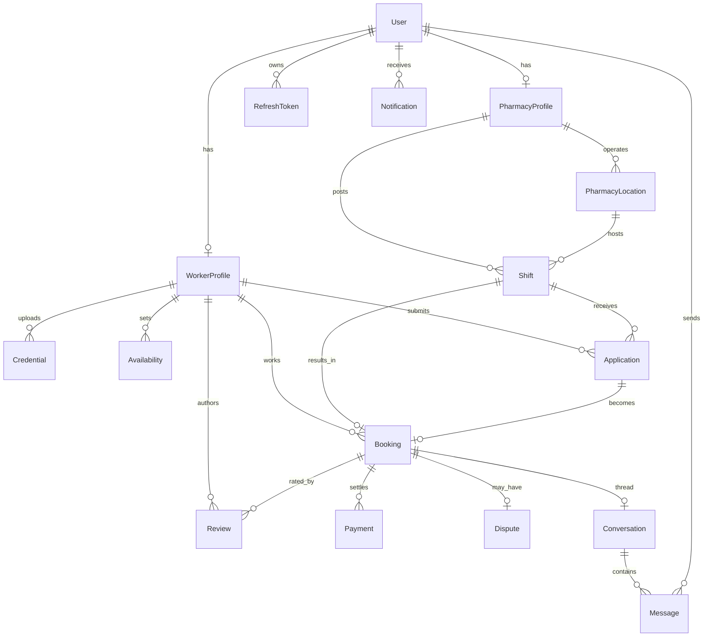

# Architecture — Pharmacy Staffing Marketplace

Status: **M1 deliverable.** Source of truth for stack, data model, API, and flows. Feature code (M2+) must conform to this document; deviations require approval and a DECISIONS.md entry.

## 1. Overview

A web platform where **workers/pharmacists** find and apply for shifts, and **pharmacies/employers** post shifts, review applications, manage bookings, message workers, and handle payments. An **admin** oversees users, verification, disputes, and reporting.

Design principle: **API-driven**. All functionality is exposed via a versioned REST API so a future mobile app can reuse the same backend. No mobile client is built now.

## 2. Stack

| Layer | Choice |
|---|---|
| Client | React + Vite + TypeScript + Tailwind CSS |
| Server | Node.js + Express + TypeScript |
| Database | PostgreSQL |
| ORM | Prisma |
| Auth | JWT (access + refresh) + Role-Based Access Control |
| Payments | Stripe (Connect for payouts) |
| File storage | Object storage (S3-compatible) for credential documents — provider chosen in M2 (ask) |
| Deploy | Cloud hosting, separate **staging** + **production** environments |

See [DECISIONS.md](DECISIONS.md) for rationale.

## 3. Repo layout
```
client/            React SPA
server/            Express API
  prisma/schema.prisma   data model (DB source of truth)
docs/ plans/ qa/   workflow system
```

## 4. Roles & RBAC

Three roles on `User.role`: **WORKER**, **PHARMACY**, **ADMIN**.

### Permission matrix (high level)

| Capability | Worker | Pharmacy | Admin |
|---|:--:|:--:|:--:|
| Manage own worker profile & availability | ✅ | — | ✅ |
| Upload credentials/documents | ✅ | — | ✅ |
| Manage pharmacy profile & locations | — | ✅ | ✅ |
| Create/manage shifts | — | ✅ | ✅ |
| Search & view open shifts | ✅ | ✅(own) | ✅ |
| Apply to shifts | ✅ | — | — |
| Accept/reject applications | — | ✅ | ✅ |
| Manage bookings (own side) | ✅ | ✅ | ✅ |
| Message counterpart in a booking | ✅ | ✅ | ✅ |
| Pay / receive payout | — | pay | receive | ✅ |
| Leave reviews (post-booking) | ✅ | ✅ | ✅ |
| Verify/approve credentials | — | — | ✅ |
| Resolve disputes & cancellations | — | raise | raise | resolve |
| Platform analytics & user management | — | — | ✅ |

RBAC is enforced by server middleware on every protected route. Ownership checks (e.g. a pharmacy may only edit its own shifts) are enforced in services.

## 5. Data model

PostgreSQL via Prisma. Full schema: [`server/prisma/schema.prisma`](../server/prisma/schema.prisma). Summary of entities:

- **User** — identity + role + status; 1:1 to a WorkerProfile or PharmacyProfile.
- **WorkerProfile** — professional info, location (lat/lng), rate expectation; has Credentials, Availability.
- **Credential** — uploaded document + verification status (PENDING/APPROVED/REJECTED).
- **Availability** — worker availability windows.
- **PharmacyProfile** — business profile; has PharmacyLocations.
- **PharmacyLocation** — a physical site (address + lat/lng) where shifts occur.
- **Shift** — a staffing need (role, time window, rate, status) at a location.
- **Application** — a worker's application to a shift (unique per worker+shift).
- **Booking** — a confirmed engagement created from an accepted application.
- **Conversation / Message** — messaging between a worker and a pharmacy.
- **Notification** — in-app/email/push notification records.
- **Payment** — Stripe charge/payout tied to a booking.
- **Review** — post-booking rating from one party about the other.
- **Dispute** — raised against a booking; resolved by admin.
- **RefreshToken** — issued refresh tokens for JWT rotation/revocation.

### ERD



## 6. API surface (v1)

Base: `/api/v1`. All non-public routes require a valid access token; RBAC per the matrix above.

**Auth**
- `POST /auth/register` · `POST /auth/login` · `POST /auth/refresh` · `POST /auth/logout` · `GET /auth/me`

**Workers**
- `GET/PUT /workers/me/profile`
- `GET/POST/DELETE /workers/me/availability`
- `GET/POST /workers/me/credentials` · `DELETE /workers/me/credentials/:id`

**Pharmacies**
- `GET/PUT /pharmacies/me/profile`
- `GET/POST/PUT/DELETE /pharmacies/me/locations`

**Shifts & marketplace**
- `GET /shifts` (search: filters, location/radius, role, date, rate)
- `GET /shifts/:id`
- `POST/PUT/DELETE /pharmacies/me/shifts` (pharmacy-owned)

**Applications**
- `POST /shifts/:id/applications` (worker applies)
- `GET /workers/me/applications`
- `GET /pharmacies/me/shifts/:id/applications`
- `PATCH /applications/:id` (accept/reject/withdraw)

**Bookings**
- `GET /bookings` (scoped to caller)
- `GET /bookings/:id`
- `PATCH /bookings/:id` (check-in/complete/cancel)

**Messaging**
- `GET /conversations` · `GET /conversations/:id/messages` · `POST /conversations/:id/messages`

**Payments**
- `POST /bookings/:id/payment-intent` · `POST /webhooks/stripe` · `GET /payments`

**Reviews**
- `POST /bookings/:id/reviews` · `GET /users/:id/reviews`

**Disputes**
- `POST /bookings/:id/disputes` · `GET /disputes` · `PATCH /disputes/:id` (admin)

**Admin**
- `GET /admin/users` · `PATCH /admin/users/:id`
- `GET /admin/credentials?status=pending` · `PATCH /admin/credentials/:id` (approve/reject)
- `GET /admin/reports`

> This map is the plan; routes are implemented per milestone (M2–M4). Exact query params finalized when each route is built.

## 7. UX — screens & primary flows

### Screen inventory
- **Public:** landing, login, register (role picker), shift browse (public preview).
- **Worker:** dashboard, profile editor, availability, credentials, shift search + detail, my applications, my bookings, messages, reviews.
- **Pharmacy:** dashboard, business profile, locations, shift create/manage, applications review, bookings, messages, payments.
- **Admin:** dashboard, users, credential verification queue, disputes, reports/analytics.

### Primary flows
1. **Worker finds & applies:** register → build profile → upload credentials → search shifts (filters/radius) → apply → get accepted → booking → complete → get paid → review.
2. **Pharmacy fills a shift:** register → business profile + location → create shift → review applications → accept one → booking → message worker → pay → review.
3. **Credential verification:** worker uploads → status PENDING → admin reviews → APPROVED/REJECTED → worker notified.
4. **Dispute:** either party raises against a booking → admin reviews → resolved.

## 8. Deployment (plan)

- **Staging** + **production** environments, each with its own Postgres and env config.
- Client: static build (Vite) served via CDN/host. Server: Node service. Specific providers chosen in M5 (ask before provisioning).
- Secrets via environment variables only — never committed.
- Third-party costs (hosting, Stripe fees, email/push) are the client's per the quotation.

## 9. Out of scope (now)
- Native mobile app (future; backend is API-ready for it).
- Ongoing maintenance/hosting management (separate engagement per quotation).
