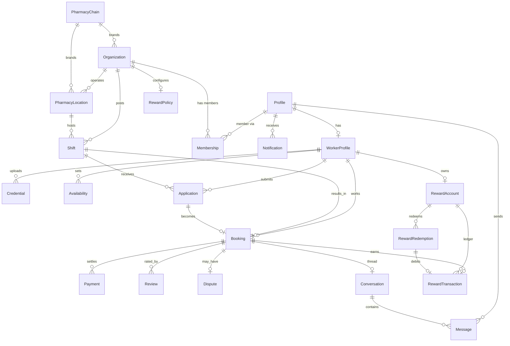

# Architecture — ShiftStarter (Pharmacy Staffing Marketplace)

Product: **ShiftStarter** · Domain: **shiftstarter.ca** · Brand: [BRAND.md](BRAND.md).

Status: **Revised 2026-11-12** after the client call (see `Bobby Seran, Zia Arsalan-transcript.txt`). This revision supersedes the M1 architecture: the platform moves to a **Supabase + hybrid-Express** stack with a **multi-tenant SaaS role model**, a **rewards system**, and **pharmacy-chain branding**. Feature code must conform to this document; deviations require approval and a DECISIONS.md entry.

## 1. Overview

A web platform where individual **workers** (pharmacists, technicians, assistants, students) find and apply for shifts, and **pharmacy organizations** post shifts, review applications, manage bookings, message workers, and handle payments. A **super admin** oversees everything across all tenants.

Two new product pillars from the client call:
- **Rewards as the growth hook** — a worker earns a configurable reward (default $5) for each completed shift, redeemable for gift cards. This is the differentiator ("nobody else is doing rewards").
- **Clean, brand-forward UX** — shift listings must be fast and uncluttered and show the **pharmacy chain logo** so workers instantly recognise where they'd work.

Design principle (unchanged): **API-driven, web-first, mobile-later.** Business logic lives behind a versioned REST API so a future mobile app can reuse the same backend. No mobile client is built now.

## 2. Stack

| Layer | Choice |
|---|---|
| Client | React + Vite + TypeScript + Tailwind CSS; `@supabase/supabase-js` for auth/session |
| Server | Node.js + Express + TypeScript (**hybrid**: owns business logic; validates Supabase JWTs) |
| Auth | **Supabase Auth** (email/password + sessions). Replaces custom JWT/argon2. Roles via custom claims + `Profile`/`Membership` tables |
| Database | **Supabase-managed PostgreSQL** |
| ORM | Prisma (schema + migrations + business-logic queries against the Supabase connection string) |
| Access control | **Supabase RLS** for tenant isolation on the client path + Express service-layer scoping |
| File storage | **Supabase Storage** (private `credentials` bucket) behind the existing `StorageProvider` interface |
| Payments | Stripe (Connect for payouts) — currency **CAD** |
| Rewards | Internal ledger + **Blackhawk** gift-card developer API for redemption |
| Deploy | Supabase (DB/Auth/Storage) + hosted Node service + static client; staging + production |

See [DECISIONS.md](DECISIONS.md) ADR-007..ADR-011 for rationale and what was superseded.

### 2.1 Hybrid request model (who does what)

- **Client → Supabase directly** (via `supabase-js`): sign-up, sign-in, sign-out, session refresh, password reset; reading the signed-in user's own `Profile`; downloading credential files via short-lived signed URLs. All governed by **RLS**.
- **Client → Express API** (Bearer = Supabase access token): everything with business rules — org/membership management, shifts, applications, bookings, matching, messaging, payments/webhooks, rewards earn/redeem, Blackhawk calls, super-admin operations.
- **Express → Supabase**: Prisma over the Supabase Postgres connection string for queries/migrations; Supabase Storage (service role) for writes; Supabase Admin API for privileged auth actions (e.g. seeding the super admin, setting custom claims).

## 3. Repo layout
```
client/            React SPA (supabase-js + API client)
server/            Express API (Prisma + Supabase JWT verify + Storage)
  prisma/schema.prisma   data model (DB source of truth)
  supabase/policies/     RLS policy SQL (authored here, applied via migration)
docs/ plans/ qa/   workflow system
```

## 4. Auth, tenancy & RLS

### 4.1 Identity
Supabase Auth owns the canonical user in `auth.users`. For every auth user we keep a 1:1 **`Profile`** row in the `public` schema whose `id` equals the Supabase auth UUID (`auth.uid()`). The Profile carries app-level fields (`platformRole`, `status`, name, phone) and is the anchor for all relations.

### 4.2 Roles (multi-tenant SaaS model)
Replaces the old flat WORKER/PHARMACY/ADMIN.

- **SUPER_ADMIN** — `Profile.platformRole = SUPER_ADMIN`, mirrored into the JWT via Supabase `app_metadata`. Platform master portal: cross-tenant control and visibility over everything.
- **Organization** (= a pharmacy tenant). Members join via **`Membership`** with an **OrgRole**:
  - **OWNER** — full control of the org (locations, shifts, staff, billing, invite/remove members).
  - **MANAGER** — manage the org's locations, shifts, applications, bookings (no billing/member removal).
- **Worker roles** (individual supply-side `WorkerProfile.workerRole`): **PHARMACIST, PHARMACY_TECHNICIAN, PHARMACY_ASSISTANT, PHARMACY_STUDENT**.

A Profile may simultaneously be a worker and an org member (a pharmacy owner who also picks up shifts). Capabilities derive from `platformRole` + `Membership` + `workerProfile`, not from a single enum.

### 4.3 Request authentication (Express)
`supabase-js` on the client sends the Supabase **access token** as `Authorization: Bearer`. Express middleware verifies it against Supabase's **JWKS** (asymmetric keys) using a JWKS verifier (e.g. `jose`), then loads the caller's `Profile`, memberships, and worker profile into `req.auth`. RBAC middleware checks platform role / org role / worker status per route; service-layer ownership checks enforce that an org only touches its own rows.

### 4.4 Tenant isolation (RLS + service scoping)
- **RLS is authoritative for the client/supabase-js path.** Policies: a Profile can read/update only its own row; org-scoped tables (Organization, Membership, PharmacyLocation, Shift, Application, Booking, reward rows) are readable/writable only by members of the owning org (resolved through `Membership` with `auth.uid()`); SUPER_ADMIN bypasses via a claim check; the `PharmacyChain` catalog is readable by all authenticated users and writable only by SUPER_ADMIN; credential files are private.
- **Express connects with a privileged role, which bypasses RLS**, so the API **must** enforce the same tenant scoping in its services (every org-scoped query is filtered by the caller's org). RLS is defense-in-depth for the API path and the primary guard for any direct client DB access. (Optionally propagating the user JWT claims to Postgres so Prisma runs under RLS is noted as an open decision.)

### 4.5 RBAC matrix

| Capability | Worker | Manager | Owner | Super Admin |
|---|:--:|:--:|:--:|:--:|
| Manage own worker profile & availability | ✅ | — | — | ✅ |
| Upload own credentials | ✅ | — | — | ✅ |
| View own reward balance & redeem | ✅ | — | — | ✅ |
| Manage org profile & chain selection | — | — | ✅ | ✅ |
| Manage org locations | — | ✅ | ✅ | ✅ |
| Create/manage shifts | — | ✅ | ✅ | ✅ |
| Review applications / accept-reject | — | ✅ | ✅ | ✅ |
| Manage bookings (org side) | — | ✅ | ✅ | ✅ |
| Invite / remove org members, billing | — | — | ✅ | ✅ |
| Search & view open shifts | ✅ | ✅(own) | ✅(own) | ✅ |
| Apply to shifts | ✅ | — | — | — |
| Message counterpart in a booking | ✅ | ✅ | ✅ | ✅ |
| Pay / receive payout | receive | pay | pay | ✅ |
| Leave reviews (post-booking) | ✅ | ✅ | ✅ | ✅ |
| Verify/approve credentials | — | — | — | ✅ |
| Manage pharmacy-chain catalog | — | — | — | ✅ |
| Configure reward policy / adjust balances | — | — | — | ✅ |
| Resolve disputes; cross-tenant analytics & user mgmt | raise | raise | raise | ✅ |

## 5. Data model

Supabase Postgres via Prisma. Full schema: [`server/prisma/schema.prisma`](../server/prisma/schema.prisma). Key changes from M1:

- **`Profile`** replaces `User` — `id` = Supabase auth UUID; no `passwordHash`; adds `platformRole`. `RefreshToken` removed (Supabase manages sessions).
- **`Organization`** replaces `PharmacyProfile` — the pharmacy tenant; `type` (PHARMACY; AGENCY reserved); optional `chainId`.
- **`Membership`** — Profile↔Organization with `OrgRole` (OWNER/MANAGER) + status; unique per (org, profile).
- **`PharmacyChain`** — platform-curated brand catalog (name, slug, logo). Organizations and locations reference it; null = independent.
- **`WorkerProfile`** — now 1:1 with `Profile`; profession captured as `workerRole` enum.
- **`PharmacyLocation`** / **`Shift`** — belong to an `Organization`; shift `roleRequired` is a `WorkerRole`; location carries an optional chain override.
- **`Application`** — adds `proposedRate` for rate negotiation seen in competitor apps.
- **Rewards:** **`RewardAccount`** (1:1 per worker, cached `balanceCents`), **`RewardTransaction`** (immutable ledger; EARN/REDEEM/ADJUST; `bookingId` unique → idempotent earn), **`RewardRedemption`** (Blackhawk request + external refs + status), **`RewardPolicy`** (configurable earn amount, default 500 cents).
- Payment/reward **currency defaults to CAD**.

### ERD



## 6. API surface (v1)

Base: `/api/v1`. Non-public routes require a valid Supabase access token (Bearer); RBAC per §4.5. Flows marked **[supabase-js]** are handled client-side directly against Supabase, not by Express.

**Auth / session — [supabase-js]**
- `signUp`, `signInWithPassword`, `signOut`, `getSession`/`refresh`, `resetPasswordForEmail`. Express has no password endpoints.
- `GET /auth/me` (Express) — returns the resolved `Profile` + memberships + worker profile + effective capabilities after a Supabase sign-in.
- `POST /auth/bootstrap` (Express) — first-login provisioning: create the `Profile` row and, per sign-up intent, a `WorkerProfile` or an `Organization`+owner `Membership`. (Alternative: a Supabase DB trigger — open decision.)

**Workers**
- `GET/PUT /workers/me/profile`
- `GET/POST/DELETE /workers/me/availability` (built in M3)
- `GET/POST /workers/me/credentials` · `DELETE /workers/me/credentials/:id`
- `GET /workers/me/credentials/:id/file` — authenticated download (streams, or issues a short-lived Supabase signed URL)

**Organizations (pharmacy tenant)**
- `GET/PUT /orgs/me` (owner) · `GET /orgs/me/members` · `POST/DELETE /orgs/me/members` (owner invites/removes)
- `GET/POST/PUT/DELETE /orgs/me/locations(/:id)` (owner/manager)

**Pharmacy chains**
- `GET /chains` (any authed; for selection + logos) · `POST/PUT/DELETE /admin/chains(/:id)` (super admin)

**Shifts & marketplace** (M3)
- `GET /shifts` (search: filters, location/radius, role, date, rate; responses include chain name+logo)
- `GET /shifts/:id`
- `POST/PUT/DELETE /orgs/me/shifts(/:id)` (org-owned)

**Applications** (M3)
- `POST /shifts/:id/applications` · `GET /workers/me/applications` · `GET /orgs/me/shifts/:id/applications` · `PATCH /applications/:id`

**Bookings** (M3)
- `GET /bookings` (scoped) · `GET /bookings/:id` · `PATCH /bookings/:id` (check-in/complete/cancel) — transition to COMPLETED triggers reward EARN.

**Rewards** (built M3)
- `GET /workers/me/rewards` — balance + transaction history
- `GET /rewards/catalog` — available gift-card brands (via Blackhawk)
- `POST /workers/me/rewards/redemptions` — request a redemption (debits ledger, calls Blackhawk)
- `GET /workers/me/rewards/redemptions(/:id)` — status/history
- `POST /webhooks/blackhawk` — provider status callbacks (if offered)
- `GET /admin/rewards/policy` · `PUT /admin/rewards/policy` · `POST /admin/rewards/adjust` (super admin)

**Messaging / Payments / Reviews / Disputes** (M4) — as M1, re-scoped to Profile/Org.
**Super admin** — `GET /admin/users`, `PATCH /admin/users/:id`, `GET /admin/orgs`, credential queue `GET/PATCH /admin/credentials`, chains, reward policy, `GET /admin/reports`.

## 7. Rewards system (design; build in M3)

**Earn.** When a `Booking` transitions to **COMPLETED**, the API creates one `RewardTransaction{ type: EARN, amountCents: policy.earnAmountCents, bookingId }` inside the same transaction and increments `RewardAccount.balanceCents`. The unique `bookingId` on the ledger makes earn idempotent; **CANCELLED and NO_SHOW bookings never earn**. Amount comes from `RewardPolicy` (platform default 500 cents = $5; org override reserved).

**Redeem.** Worker picks a gift-card brand/amount → API validates balance → creates `RewardRedemption{ PENDING }` + a REDEEM ledger entry (balance held) → calls the **Blackhawk** developer API to request the card → stores `externalOrderId`/`externalCardRef`, moves status REQUESTED→FULFILLED on success, or FAILED (restoring balance) on error. Status tracked for reconciliation; webhook used if Blackhawk provides one.

**Admin.** Super admin configures the earn amount via `RewardPolicy` and can post `ADJUST` entries (with note) for corrections.

**M3 prerequisites (client-provided):** Blackhawk developer account, API credentials/keys, sandbox access, and the gift-card catalog/regions. Without these, redemption can be stubbed behind the same interface. Flagged as a dependency.

## 8. Pharmacy-chain branding & clean UX

- **Branding.** `PharmacyChain` is a platform-curated catalog (super admin adds major Canadian chains + logos; Bobby will supply them). Organizations/locations reference a chain; independents leave it null. Shift listings render the chain name + logo so a worker instantly recognises the brand. Logos live in Supabase Storage (or a public brand-assets path).
- **Clean-UX guideline (M3).** Direct response to Bobby's competitor critique ("the screen is very cluttered"). Shift listings must be scannable: one card per shift, chain logo + pharmacy name, role, date/time, rate, distance — nothing else above the fold; progressive disclosure for detail; generous whitespace; mobile-first. Follow [BRAND.md](BRAND.md) (navy headings, `brand-blue` primary, azure accents for large elements only). "Get your shift started" — fast, uncluttered, recognisable.

## 9. File storage (Supabase Storage)

Credential documents live in a **private** Supabase Storage bucket (`credentials`). The existing `StorageProvider` interface (`server/src/lib/storage/types.ts`) is retained; the local-disk impl is swapped for a **Supabase Storage** impl (service-role writes server-side; downloads via authenticated endpoint or short-lived signed URLs). Files are never public. Chain/brand logos may use a separate public `brand-assets` bucket.

## 10. UX — screens & primary flows

### Screen inventory (updated)
- **Public:** landing, login, register (intent picker: "I'm a worker" vs "I run a pharmacy"), shift browse preview (brand-forward, clean).
- **Worker:** dashboard, profile (profession/role), availability, credentials, shift search + detail, my applications, my bookings, **rewards (balance, history, redeem)**, messages, reviews.
- **Organization (owner/manager):** dashboard, org profile + chain selection, members/staff, locations, shift create/manage, applications review, bookings, messages, payments.
- **Super admin:** dashboard, users, organizations, credential verification queue, **pharmacy-chain catalog**, **reward policy & adjustments**, disputes, reports/analytics.

### Primary flows
1. **Worker:** sign up → build profile (role) → upload credentials → search shifts (clean, brand-forward) → apply (optionally propose rate) → accepted → booking → complete → **earn reward** → redeem for gift card → review.
2. **Pharmacy org:** owner signs up → org created + chain selected → add location(s) → create shift → review applications → accept → booking → message worker → pay → review. Owner invites managers.
3. **Credential verification:** worker uploads → PENDING → super admin reviews → APPROVED/REJECTED → worker notified.
4. **Super admin:** manage tenants/users, curate chain catalog, set reward policy, resolve disputes, view cross-tenant analytics.

## 11. Deployment (plan)

- **Supabase project** per environment (staging + production): managed Postgres, Auth, Storage. Client-provided/owned.
- Server: Node service (hosting provider chosen in M5) connecting via Supabase pooled + direct connection strings; holds Supabase service-role key and Stripe/Blackhawk secrets (env only, never committed).
- Client: static Vite build; holds only the Supabase URL + anon key + API base URL.
- RLS policies applied via migration to each environment. Secrets via environment variables only.
- Third-party costs (Supabase, Stripe fees, Blackhawk, email/push, hosting) are the client's per the quotation.

## 12. Out of scope (now)
- Native mobile app (future; backend is API-ready).
- Staffing **agencies** as tenants (model reserves `OrganizationType.AGENCY`; not built — open decision).
- Ongoing maintenance/hosting management (separate engagement).

## 13. Commercial note
Supabase adoption, the multi-tenant SaaS model, the rewards system (incl. Blackhawk), and pharmacy-chain branding are **expansions beyond the original $2,200 / 5-milestone quotation**. Flagged for the user as a commercial matter (not an engineering decision). See MILESTONES.md.
